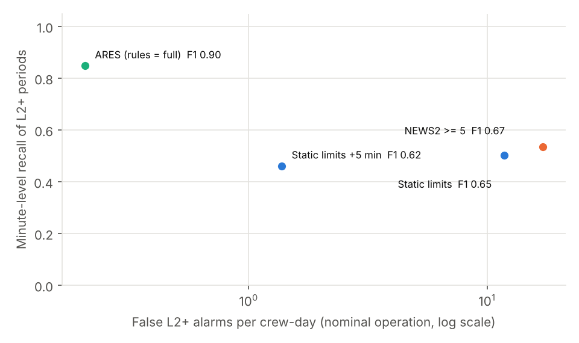
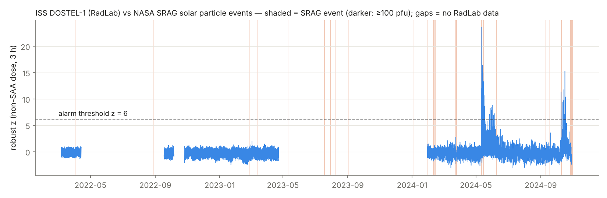
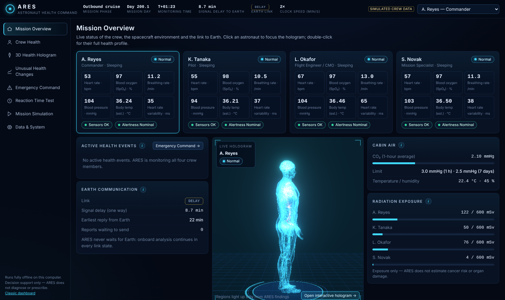
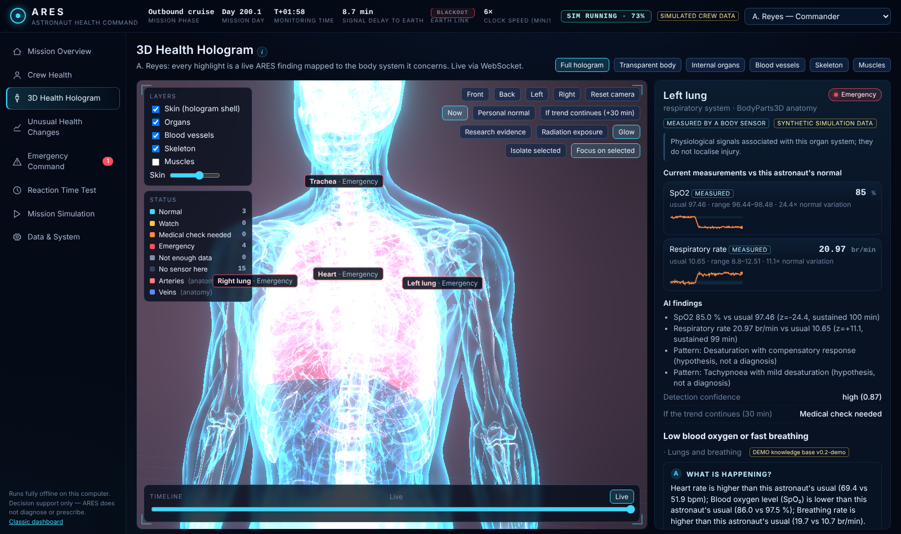
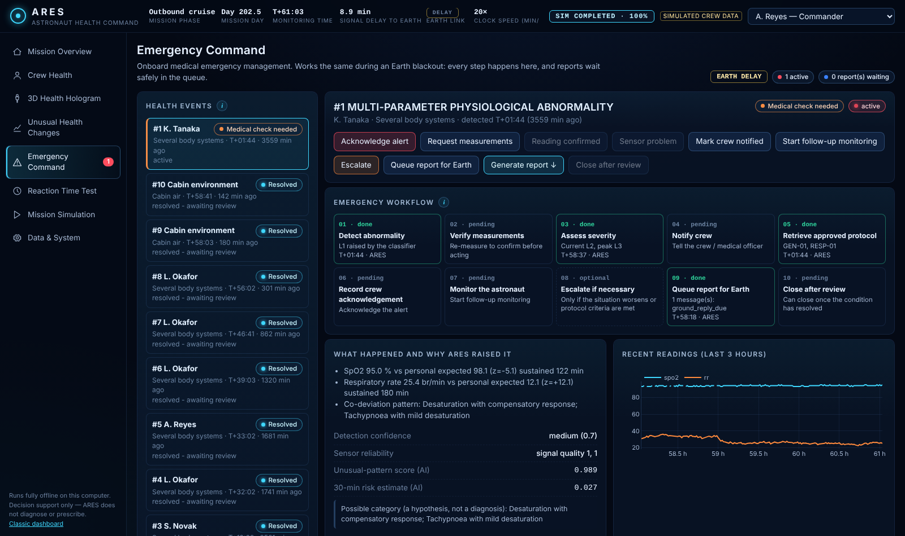
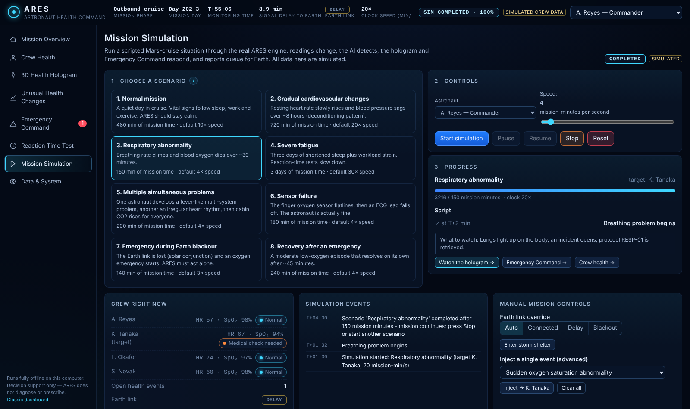
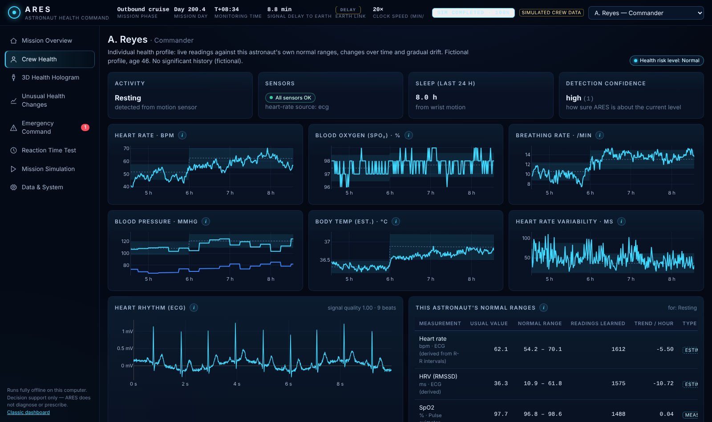
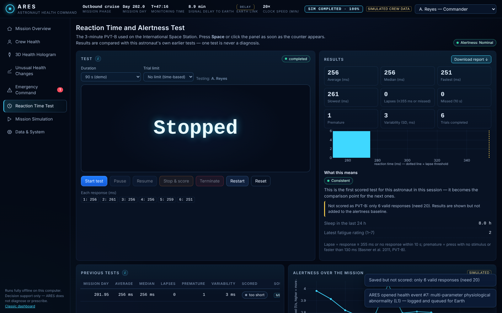

# ARES — Autonomous Risk Evaluation & Emergency Support
**Keeping Humanity Alive Beyond Earth** · NASA Space Apps Challenge 2026 · *The Next Frontier*

**Challenge:** *Create Health Monitoring Software for Astronauts on Space Missions*
(physical **and** mental health on long-duration missions beyond Earth orbit — see
[`docs/01_CHALLENGE_ALIGNMENT.md`](docs/01_CHALLENGE_ALIGNMENT.md)).

> **Research prototype. Not a medical device. All crew data in the demo are SIMULATED**; real data are
> used for space weather and for validating the signal-processing chain. See [`docs/LIMITATIONS.md`](docs/LIMITATIONS.md).

## The problem
On the way to Mars the crew is up to ~20 light-minutes from Earth; a question to a flight surgeon can
take 40 minutes to answer, and during solar conjunction there is no link at all. A monitor that only
displays vital signs leaves the crew to interpret them alone. ARES is an onboard system that
**understands each astronaut's own normal**, notices meaningful change across physiological,
behavioral and environmental signals, explains *why*, retrieves the approved procedure, and decides
what to tell Earth and when — without assuming Earth can intervene.

## What ARES does
| Layer | What is implemented | Code |
|---|---|---|
| Acquisition | ECG, SpO₂ + pulse rate, respiration, BP cuff (intermittent), temperature, actigraphy, dosimeter, cabin CO₂/T/RH; missing data, plausibility, flatline, lead-off, perfusion, sensor redundancy | `ares/simulation`, `ares/processing/quality.py` |
| Signal processing | Zero-phase band-pass, Pan–Tompkins R-peaks, HR/RMSSD/SDNN, LF/HF only for ≥2-min windows, ECG quality index | `ares/processing/ecg.py` |
| Digital twin | Bayesian (NIG) personal baselines per activity context with uncertainty, forgetting + z-gating, Kalman trends, longitudinal drift, timeline | `ares/twin` |
| Intelligence | Isolation Forest (nominal-only), calibrated 30-min risk forecaster + SHAP, co-deviation patterns, rolling correlations | `ares/intelligence` |
| Emergency | Rule-based L0–L3 (severity, duration, deterioration rate, systems, sensor quality, personal history, uncertainty), hysteresis, explainable reports, verbatim protocol retrieval | `ares/emergency` |
| Mission | Hohmann trajectory, light time, connected/delay/blackout modes, prioritised store-and-forward queue | `ares/mission` |
| Radiation | Measured vs modelled (MSL/RAD rates) vs *inferred risk – not computed*; SPE detection; NASA DONKI SEP feed | `ares/radiation` |
| Behavioral (private) | PVT-B (as on ISS), Samn-Perelli, mood/stress check-ins, sleep debt → readiness; Earth gets category only | `ares/behavioral` |
| Cabin | ppCO₂ vs NASA-STD-3001 limits; **crew-wide attribution** (environment vs individual illness) | `ares/environment` |
| Clinical | Symptom reports + lab results vs own pre-flight values (immune markers need labs) | `ares/clinical` |
| Assistant | Retrieval-only: explanations, history, inventory, reports, protocols with citations; never generates medical text | `ares/assistant` |
| System | Offline-first FastAPI service, hash-chained SQLite store, model monitoring (drift, OOD), model-file hash checks | `ares/api`, `ares/storage.py` |

## Results (held-out synthetic astronauts + real PhysioNet ECG)
Full numbers, method and **open issues**: [`reports/EVALUATION.md`](reports/EVALUATION.md). All emergency scenarios are simulated;
6 synthetic astronauts never seen in training, 72 episodes.

| | Static alarm limits | NEWS2 ≥ 5 | **ARES** |
|---|---|---|---|
| Emergencies detected (L2+), 48 events | 85% | 98% | **100%** (0/24 critical missed) |
| False serious alarms per crew-day | 11.8 | 17.1 | **0.38** |
| Minute-level F1 (L2+) | 0.65 | 0.67 | **0.90** |
| False medical escalations during sensor failures (6 episodes) | 3 | 32 | **0** |

- **Communication blackout:** same detection latency with the link down (3.5 min) as up.
- **Solar particle events:** 6/6 detected, median 7 min after onset.
- **30-min risk forecaster:** ROC-AUC 0.81, PR-AUC 0.32 (base rate 0.02), calibration error 0.005;
  collapses on emergency types it never saw, which is why ML may only raise *observation*.
- **Behavioral readiness:** simulated sleep restriction flagged in 100% of subjects (median 1 day); 15% of controls falsely flagged over 8 days.
- **Real ECG (PhysioNet MIT-BIH record 100, cardiologist annotations):** beat sensitivity 99.6%, PPV 100.0%,
  HR error 0.09 bpm per 10-s window. **drivedb (real driving stress):** ARES HR within 5 bpm of the device in 90% of windows.
  Weakness: the ECG quality index degrades too slowly below ~3 dB SNR ([report](reports/REAL_DATA_VALIDATION.md)).



## Results on real NASA data ([full report](reports/REAL_NASA_DATA.md))
Every number below is computed by `scripts/real_nasa_models.py` from NASA OSDR / ALSDA / RadLab files plus the NASA JSC
SRAG solar-event list. Nothing comes from the simulator.

| Model | Real data | Result |
|---|---|---|
| **D** Radiation event detection | RadLab DOSTEL-1 on ISS, 490,504 readings 2022–24; 33 SRAG solar proton events | 2024 held out: **3/10 strong (≥100 pfu) events detected, 1.7 false alarms / 30 days**; naive daily-mean detector: 0. Most SEPs never reach a dosimeter inside the magnetosphere, which is why a Mars crew needs onboard detection. |
| **E** Personal baseline on astronaut labs | Inspiration4 CBC, CMP, 71 cytokines (OSD-569/575), 4 crew × 7 time points | 9 of 17 generic-range post-flight flags only repeat that person's pre-flight trait; pre-flight false-flag rate 4.2% (personal) vs 5.2% (generic). Row-level QC caught a column-shifted sample (C003 L-92). |
| **C** Spaceflight soleus response | OSD-662 western blot, 83 mice, RR-1 / RR-9 / RR-18 / Bion-M1 | Leave-one-mission-out AUC 0.71–0.98. A single MHC IIx rule does as well, so ARES shows the simple rule. |
| Bone | OSD-654 tibia microCT (RR-9) | Cortical thickness −11.8% vs habitat ground control (g −2.08, p 0.03, n = 4 vs 5) |



## Screens (v0.3 interface)
One React app at **http://127.0.0.1:8000** (old dashboard kept at `/classic`). Eight pages: Mission Overview · Crew Health ·
3D Health Hologram · Unusual Health Changes · Emergency Command · Reaction Time Test · Mission Simulation · Data & System.

| Mission overview with live hologram | Hologram during an oxygen emergency (auto-focus on lungs) |
|---|---|
|  |  |
| **Emergency Command**: 10-step workflow with real actions | **Mission Simulation**: 8 scripted scenarios through the real engine |
|  |  |
| **Crew Health**: personal normal ranges, changes over time, gradual drift | **Reaction Time Test** (PVT-B) with millisecond results |
|  |  |

### What each part does
- **3D Health Hologram:** BodyParts3D anatomy (CC BY 4.0) in a holographic shader with layers for skin, organs, vessels,
  skeleton and muscles. Regions light up only from ARES findings (`ares/anatomy/mapping.py`). Click a region for its
  measurements against the astronaut's own normal, the AI findings, and four-part guidance.
- **Four-part guidance:** What is happening (live data), Immediate action (verbatim stored protocols), Possible long-term effects
  (NASA-recognised risks / NASA research / theoretical, each sourced) and Long-term care. See
  `knowledge_base/health_guidance.json` and `ares/emergency/guidance.py`.
- **Emergency Command:** acknowledge, request measurements, confirm or flag a sensor issue, notify the crew, follow-up
  monitoring, escalate (raises the level floor and sends a P1 message to Earth), queue for Earth, generate a Markdown report,
  and close after review (refused while still abnormal). There is an event timeline, and it works during a blackout.
- **Health changes over time / Gradual changes from normal:** hourly resting averages compared with the astronaut's own
  reference period. Statuses: stable, watch, gradual change, or sudden change (handed to the alert system).
- **Reaction Time Test:** ready, countdown, running, paused, completed or terminated, with one session at a time.
  Timing uses `performance.now` and event timestamps. Shows mean, median, fastest, slowest, lapses, misses, premature
  responses and variability, a histogram, history, a downloadable report, and an interpretation against the astronaut's
  own earlier tests.
- **Mission Simulation:** start, pause (clock really stops), resume, stop, reset (rebuilds the engine) and speed. The
  scenarios are normal, gradual cardiovascular, respiratory, severe fatigue, multiple problems, sensor failure, blackout
  emergency and recovery.
- **Offline:** `python scripts/offline_check.py` opens every page with all non-local requests blocked. Result: 0 external
  requests, and every page, ML inference, the knowledge base and the database work.
- **API groups:** `/api/astronauts`, `/health`, `/health/history`, `/drift`, `/anomalies`, `/emergencies`
  (+ `/{id}/action`, `/{id}/report.md`), `/pvt/{id}`, `/mission`, `/simulation/{start|pause|resume|stop|reset}`,
  `/medical-guidance` (+ `/search`) and `/system/status`. Optional local auth: set `ARES_TOKEN`.
- Audit of the old app and the changes made: [docs/AUDIT.md](docs/AUDIT.md).

## Test history and organ dossiers (v0.5)

Every test performed in ARES is saved permanently in the local database:

- **What's saved:** reaction tests (with every trial), wellness check-ins, symptom reports and blood-test entries.
- **Status:** each record is marked completed, stopped, terminated or interrupted.
- **Where to see it:** the **Test History** page has filters, detailed results, a comparison with the previous test and the personal baseline, longitudinal trends, and CSV/PDF export.

On the **3D hologram**, clicking any organ opens its actual health events: measurements against the astronaut's own baseline, the evidence, onboard procedures, long-term effects and management, and history. An organ without data says so. Details and acceptance results are in [docs/TEST_HISTORY_AND_ORGANS.md](docs/TEST_HISTORY_AND_ORGANS.md).

## Desktop app (offline, no terminal)

ARES also ships as a standalone desktop program: double-click **ARES** and it starts its own local service, checks and backs
up its data, loads the AI models and the 3D anatomy, and opens in its own window. It needs no internet, Python or Node.js
on the target PC. Build it on Windows with `desktop\build_windows.bat`, which produces the app, a portable zip and the
`ARES-Setup-0.4.0.exe` installer. Or run the *Build ARES desktop* GitHub Action. Details, the offline test report and
troubleshooting are in [docs/DESKTOP.md](docs/DESKTOP.md).

## Quick start
```bash
python -m venv .venv && source .venv/bin/activate      # Windows: .venv\Scripts\activate
pip install -r requirements.txt
python -m ares.api.server                              # http://127.0.0.1:8000  (ARES_SPEED=4 for faster sim)
```
Trained models are included in `models/`. To reproduce everything:
```bash
python scripts/fetch_data.py           # real data: NASA DONKI, PhysioNet (needs internet)
python scripts/generate_data.py        # simulated episodes, astronaut-level split (~10 min, 2 cores)
python scripts/train_models.py         # anomaly model + risk forecaster
python scripts/evaluate.py             # -> reports/EVALUATION.md (+ figures, JSON)
python scripts/validate_real_data.py   # -> reports/REAL_DATA_VALIDATION.md
python scripts/real_nasa_models.py     # Models C/D/E on data/osdr (OSDR, RadLab) -> reports/REAL_NASA_DATA.md
pytest                                 # unit + system + API tests
```
Docker: `docker build -t ares . && docker run --rm -p 8000:8000 ares`. API docs at `/docs`.

## Repository structure
```
ARES/
├── ares/
│   ├── config.py              # every threshold: published (with source) or engineering choice
│   ├── engine.py              # per-minute orchestration of all layers
│   ├── processing/            # ECG filtering, R-peaks, HRV, signal quality, sensor faults
│   ├── twin/                  # Bayesian baselines, context estimator, Kalman trend, digital twin
│   ├── intelligence/          # features, Isolation Forest, risk forecaster, SHAP, patterns, NEWS2
│   ├── emergency/             # L0-L3 classifier, reports, protocol retrieval
│   ├── mission/               # trajectory, light time, comm modes, priority queue
│   ├── radiation/             # dose tracking, SPE detector, NASA DONKI client
│   ├── behavioral/            # PVT-B scoring, readiness model, behavioral simulator
│   ├── environment/           # cabin CO2/T/RH monitor + crew-wide attribution
│   ├── clinical/              # symptoms + lab results
│   ├── assistant/             # retrieval-only knowledge assistant
│   ├── simulation/            # crew physiology, ECG synthesis, 13 scenarios, profiles
│   ├── data/generate.py       # episode generation, astronaut-level split
│   ├── storage.py             # offline SQLite store with SHA-256 hash chain
│   ├── api/server.py          # FastAPI service + mission clock
│   └── web/                   # command dashboard (HTML/CSS/JS, Plotly served locally)
├── knowledge_base/            # protocols.json (DEMO, unapproved), medical_inventory.json
├── models/                    # trained models, model card (hashes), feature ranges
├── scripts/                   # fetch_data, generate_data, train_models, evaluate, validate_real_data
├── reports/                   # EVALUATION.md, REAL_DATA_VALIDATION.md, figures, JSON
├── data/external/             # PhysioNet records used for validation (ODC-By 1.0)
├── docs/                      # alignment, research & data, innovation, architecture, roadmap, limitations, demo
├── tests/                     # pytest suite
├── requirements.txt · Dockerfile · pytest.ini
```

## Documentation
- [A+B Challenge alignment & critique](docs/01_CHALLENGE_ALIGNMENT.md)
- [C Research & NASA/partner datasets](docs/02_RESEARCH_AND_DATA.md)
- [D Technical contribution](docs/03_INNOVATION.md)
- [E Architecture](docs/04_ARCHITECTURE.md)
- [F Hackathon MVP vs roadmap](docs/05_MVP_VS_ROADMAP.md)
- [Limitations](docs/LIMITATIONS.md) · [Demo script + judge Q&A](docs/DEMO_SCRIPT.md)
- [Evaluation report](reports/EVALUATION.md) · [Real-data validation](reports/REAL_DATA_VALIDATION.md) · [Real NASA data models](reports/REAL_NASA_DATA.md)

## Data credits
NASA CCMC DONKI; NASA OSDR (GeneLab, ALSDA, RadLab): OSD-569, OSD-575, OSD-662, OSD-654, OSD-663, OSD-104, OSD-770,
RadLab DOSTEL-1 (DLR); NASA JSC SRAG SEP list (via fetchsep, K. Whitman et al.); BodyParts3D © DBCLS (CC BY 4.0);
PhysioNet MIT-BIH Arrhythmia Database
(Moody & Mark 2001; Goldberger et al. 2000; ODC-By 1.0); PhysioNet drivedb (Healey & Picard 2005).
Standards: NASA-STD-3001 Vol 1 & 2. Instruments: PVT-B (Basner et al. 2011; ISS Reaction Self Test).
