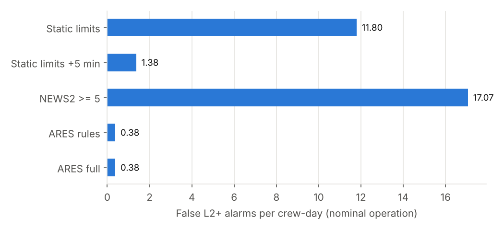
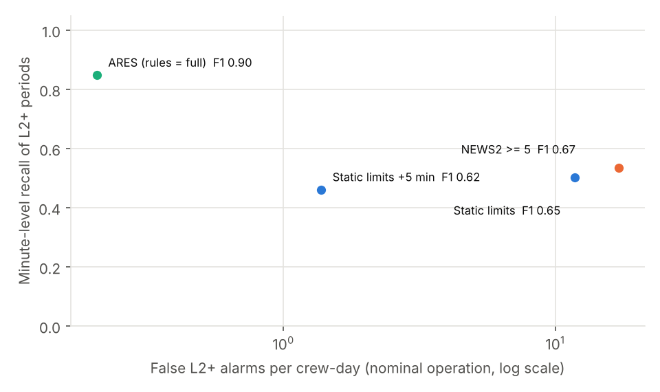
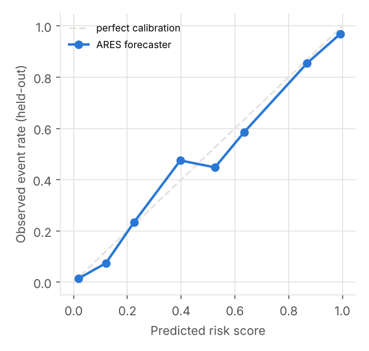

# ARES evaluation report

> SIMULATED. Held-out synthetic subjects [100, 101, 102, 103, 104, 105] never seen in training (astronaut-level split).

All numbers below come from `scripts/evaluate.py` and `reports/evaluation.json`. They measure whether ARES recovers the scenario designer's labels on **simulated** physiology. They are **not** clinical performance.

## 1. Emergency detection vs baselines

| System | Events | Recall (L2+) | Median latency (min) | Missed critical | False L1+ alerts / crew-day | False L2+ alerts / crew-day | Minute F1 (L2+) |
|---|---|---|---|---|---|---|---|
| Static limits | 48 | 0.85 | 4.0 | 0/24 | 11.80 | 11.80 | 0.65 |
| Static limits +5 min | 48 | 0.85 | 16.0 | 0/24 | 1.38 | 1.38 | 0.62 |
| NEWS2 >= 5 | 48 | 0.98 | 3.0 | 0/24 | 17.07 | 17.07 | 0.67 |
| ARES rules | 48 | 1.00 | 3.0 | 0/24 | 0.92 | 0.38 | 0.90 |
| ARES full | 48 | 1.00 | 3.0 | 0/24 | 1.68 | 0.38 | 0.90 |

Negative latency = ARES reached L2 before the scenario's own L2 label (counted in over-triage below).

## 2. Sensor failure

| System | False medical escalations (L2+) |
|---|---|
| Static limits | 3 over 6 episodes |
| Static limits +5 min | 1 over 6 episodes |
| NEWS2 >= 5 | 32 over 6 episodes |
| ARES rules | 0 over 6 episodes |
| ARES full | 0 over 6 episodes |

ARES raised a 'verify sensor' observation after a median of 12.0 min.

## 3. Communication blackout

Median latency with Earth link forced down: **3.5 min**; same event with link up: **3.5 min**.

## 4. Radiation (SPE)

SPE detected in 6/6 episodes, median 7.0 min after onset (60-min ramp).

## 5. Anomaly models (held-out subjects)

| Model | ROC-AUC | PR-AUC | Precision | Recall | F1 | Nominal false-alarm rate | Median latency vs L1 (min) | Flags sensor-fault minutes |
|---|---|---|---|---|---|---|---|---|
| Isolation Forest (deployed) | 0.7639 | 0.8587 | 0.992 | 0.477 | 0.644 | 0.0054 | 2.0 | 0.0 |
| Local Outlier Factor | 0.7548 | 0.8541 | 0.99 | 0.493 | 0.659 | 0.0068 | 0.0 | 0.0 |
| One-Class SVM | 0.7499 | 0.8527 | 0.991 | 0.495 | 0.66 | 0.0062 | 0.0 | 0.003 |
| Autoencoder (MLP 14-10-4-10-14) | 0.7523 | 0.8512 | 0.993 | 0.468 | 0.636 | 0.0045 | 1.0 | 0.003 |
| Baseline: max personal z | 0.7547 | 0.852 | 0.993 | 0.456 | 0.625 | 0.0043 | 0.0 | 0.003 |

Setup: {'positives': 'minutes with truth level >= 1 (no sensor fault)', 'negatives': 'pre-onset nominal minutes', 'threshold': '99.5th pct of nominal validation scores', 'fit': 'nominal minutes of train subjects 0-11'}

## 6. Risk forecaster (30-min horizon)

Base rate 0.0199 over 81,497 held-out minutes.

| Model | ROC-AUC | PR-AUC | Brier | ECE |
|---|---|---|---|---|
| Gradient boosting + isotonic (deployed) | 0.8103 | 0.3222 | 0.0154 | 0.0049 |
| Logistic regression | 0.7838 | 0.3134 | 0.0158 | 0.002 |
| Baseline: max personal z (score only) | 0.6904 | 0.2207 | - | - |

By time to event (positives only, vs all negatives):

- 1-10 min ahead: ROC-AUC 0.8322 (n=540)
- 11-20 min ahead: ROC-AUC 0.8286 (n=540)
- 21-30 min ahead: ROC-AUC 0.7701 (n=540)

Leave-one-scenario-out (PR-AUC on that scenario + normal episodes):

| Held-out scenario | Seen in training | Unseen in training |
|---|---|---|
| spo2_drop | 0.034 | 0.0246 |
| cardiac_arrhythmia | 0.0212 | 0.0189 |
| respiratory | 0.4826 | 0.0218 |
| dehydration | 0.5875 | 0.009 |
| gradual_deterioration | 0.5571 | 0.3781 |
| multi_system | 0.8898 | 0.1469 |
| blackout_emergency | 0.0258 | 0.027 |
| recovery | 0.0125 | 0.0104 |

## 7. Level confusion (rows = designer truth L0-L3, cols = ARES)

| | L0 | L1 | L2 | L3 |
|---|---|---|---|---|
| L0 | 56631 | 2035 | 283 | 0 |
| L1 | 21654 | 793 | 538 | 283 |
| L2 | 3547 | 636 | 4731 | 5066 |
| L3 | 9 | 25 | 2679 | 11099 |

Over-triage minutes 8,205; under-triage minutes 28,550.

Where the under-triage minutes come from:

| Scenario | Truth | ARES | Minutes | Interpretation |
|---|---|---|---|---|
| sleep_deprivation | L1 | L0 | 21,338 | by design: fatigue is handled by the behavioral channel (section 8), not physiological alarms |
| radiation_event | L2 | L0 | 3,479 | by design: SPE is an environmental incident (section 4); medical level unaffected |
| cardiac_arrhythmia | L3 | L2 | 1,703 | OPEN ISSUE 1: irregular tachycardia with falling BP held at L2; fix = 'unstable rhythm' rule (pattern + BP below personal band -> L3) |
| dehydration | L2 | L1 | 547 | slow onset: ARES one level below designer label |
| blackout_emergency | L3 | L2 | 525 | OPEN ISSUE 2: hours into sustained desaturation at the 85% limit, exercise context downgrades to L2; fix = no de-escalation while a critical value persists |
| spo2_drop | L3 | L2 | 451 | OPEN ISSUE 2 (same as above) |
| dehydration | L1 | L0 | 215 | slow onset: ARES one level below designer label |
| gradual_deterioration | L1 | L0 | 80 |  |

## 8. Behavioral readiness (simulated sleep restriction)

- Restricted arm flagged within 8 days: 100% (median 1.0 days)
- Control arm falsely flagged within 8 days: 15%

## Open issues found by this evaluation (not fixed post-hoc, to keep the held-out test clean)

1. **Unstable irregular tachycardia under-triaged** (L2 instead of L3). Proposed rule: irregular-rhythm pattern + systolic BP below the personal band -> L3 (clinical 'unstable tachycardia' logic).
2. **Sustained critical desaturation downgraded during exercise/recovery.** Proposed rule: once L3 is reached on a critical-limit channel, do not de-escalate while that channel stays beyond its hard limit, regardless of context.
3. **ML observation alerts.** The ML layer adds ~0.8 L1 alerts per crew-day over the rules alone with no gain in L2+ recall on these scenarios; its value is earlier *observation*, which should be confirmed on real data.
4. **Unsupervised anomaly models ~ simple max personal z** (ROC-AUC 0.75-0.76 for all). The personal baseline does most of the work; the Isolation Forest is kept for patterns no rule anticipated, but is not a major contributor here.
5. **Forecaster does not generalise to unseen emergency types** (leave-one-scenario-out PR-AUC collapses for respiratory, dehydration, multi-system). This is why ML is never allowed to declare an emergency.

Both rule fixes must be validated on a NEW set of held-out subjects, not on this one.

## Limitations

- Ground truth is the simulator designer's labelling, so these metrics test internal consistency, not clinical validity.
- The forecaster learns the simulator's dynamics; leave-one-scenario-out shows how much drops on an unseen event type.
- Real-data validation of the ECG chain is reported separately in `reports/REAL_DATA_VALIDATION.md`.
