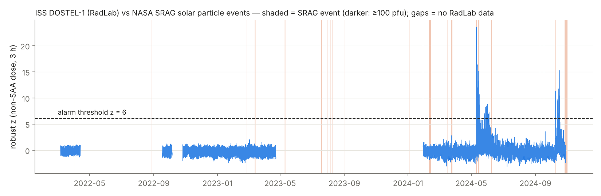
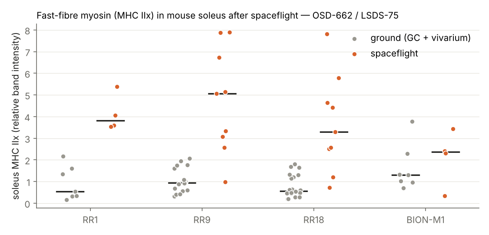

# ARES on real NASA data

All numbers below are computed by `scripts/real_nasa_models.py` from files in `data/osdr/` (NASA OSDR / ALSDA / RadLab) and `data/external/SRAG_SEP_List.csv` (NASA JSC Space Radiation Analysis Group event list). Category for every result: **REAL NASA DATA → MODEL-GENERATED ESTIMATES**. Nothing here is from the simulator.

## Model D — solar particle events on a real ISS dosimeter

* Data: 490,504 DOSTEL-1 readings (ISS Columbus), 2022-03-01 → 2024-10-29, 529.6 days with data (large gaps May–Aug 2022 and May–Dec 2023).
* Labels: 33 SRAG solar proton events (GOES >10 MeV) in the window; 20 overlap RadLab data.
* Method: drop trapped-belt (SAA) readings (≥30), take the 90th percentile of the rest per 3 h (high-latitude part of the orbit, where solar protons can penetrate), robust z vs the previous 7 days. Alarm at z ≥ 6, fixed a priori.
* Split: 2022–2023 = development, **2024 = held-out**.

| | held-out 2024 |
|---|---|
| evaluable SRAG events | 15 |
| detected (z ≥ 6) | **3** |
| strong events (≥100 pfu) detected | **3 / 10** |
| false-alarm episodes per 30 days | 1.72 |
| naive comparator (daily mean dose, z ≥ 3) detected | 0 |

| SRAG event start | peak >10 MeV (pfu) | max z | detected |
|---|---|---|---|
| 2022-03-28 13:25 | 18.7 | 0.8 | no |
| 2022-03-31 06:20 | 10.6 | -0.7 | no |
| 2022-04-02 14:30 | 32.2 | 0.8 | no |
| 2023-02-25 21:10 | 58.8 | 1.0 | no |
| 2023-03-13 07:45 | 22 | 1.2 | no |
| 2024-01-29 06:15 | 137 | 1.0 | no |
| 2024-02-09 15:30 | 187 | 0.8 | no |
| 2024-02-12 08:05 | 117 | 1.2 | no |
| 2024-02-14 09:10 | 47.7 | 0.8 | no |
| 2024-03-15 20:50 | 16.7 | 1.2 | no |
| 2024-03-23 04:00 | 956 | 2.8 | no |
| 2024-05-10 13:35 | 206.9 | 0.1 | no |
| 2024-05-11 02:10 | 116.4 | 23.6 | yes |
| 2024-05-13 14:00 | 120.9 | 15.8 | yes |
| 2024-06-08 02:55 | 1028.5 | 4.2 | no |
| 2024-07-23 03:00 | 24.8 | 2.5 | no |
| 2024-09-09 08:50 | 34.2 | 0.7 | no |
| 2024-09-17 07:35 | 33.6 | 1.0 | no |
| 2024-10-09 05:05 | 1812 | 11.3 | yes |
| 2024-10-26 18:05 | 363.7 | 1.7 | no |

**What this shows.** Inside the ISS, in low Earth orbit, the magnetosphere hides most solar particle events from the dosimeter: even 956–1,028 pfu events barely move it. The events ARES does see (May 11 and 13, 2024 and Oct 9, 2024) are the ones where protons reached ISS latitudes. The SAA-dominated daily mean finds none. A threshold calibrated on quiet 2022–2023 data (z = 1.35) gives 12.1 false alarms per 30 days in 2024 (solar maximum), so calibration does not transfer across the solar cycle. That is why ARES uses a fixed robust rule and reports it.

**Why it matters for Mars.** In interplanetary space there is no magnetosphere, so every SEP reaches the crew. Validated against ISS data, ARES detects the cases that physically reach the detector; deep-space validation needs MSL/RAD or Artemis data (roadmap).

## Model E — Inspiration4 crew: personal baseline vs generic reference range

* Data: OSD-569 (CBC) + OSD-575 (CMP, serum cytokines); 4 crew; 27 clinical markers; pre-flight L-92/L-44/L-3, post-flight R+1/R+45/R+82/R+194.
* Personal z = (value − own pre-flight mean) / SD, where SD = max(own pre-flight SD, within-person CV of the *other* crew × mean). Flag at |z| ≥ 3. Pre-flight z uses leave-one-out (empirical false-alarm rate).

* **Data-quality catch:** sample C003 L-92 (CBC) excluded by ARES row-level QC: absolute_neutrophils = 10.1 (lab range 1500.0–7800.0), mpv = 330.0 (lab range 7.5–12.5), platelet_count = 12.9 (lab range 140.0–400.0). The pattern looks like a column shift in the transformed file.
* LSDS-7 labels hemoglobin 'percent'; values and range (13.2-17.1) are g/dL.

| | generic lab range | ARES personal baseline |
|---|---|---|
| pre-flight flag rate (no flight effect possible) | 5.2% | 4.2% |
| post-flight flags (n = 430 marker-timepoints) | 17 | 8 |
| …of which only repeat that person's pre-flight trait | 9 | 0 by construction |
| flags raised only by this method | 16 | 7 |

Personal-baseline flags at R+1: C003 alt 19.0 vs own 12.67 (z +3.72, generic normal); C001 alt 9.0 vs own 14.67 (z -3.14, generic normal).

Cytokines (71 analytes): no analyte moved the same direction (|z| ≥ 2) in ≥3 of 4 crew at R+1; pre-flight leave-one-out flag rate 4.5%. Exploratory: 71 analytes x 4 crew, no multiplicity correction; shown as hypotheses only.

**Reading.** On a 3-day mission few large changes are expected, and few are found. Most generic flags describe a person's stable normal (e.g. one crew member's haemoglobin is below the generic range at every time point), which is the alarm fatigue ARES is designed to remove. n = 4: this is a demonstration of the method, not a clinical validation.

## Model C — spaceflight soleus response (mice), leave-one-mission-out

* Data: OSD-662 / LSDS-75 soleus western blot, 83 mice (28 flight) from BION-M1, RR1, RR18, RR9. Features: mhc_i, mhc_iia, mhc_iix (log2). Relative western-blot band intensities (normalised within study); mice, not humans. In RR-1 rows the GSK3-beta and pSer9 columns are identical, so GSK3 is not used as a feature.

| held-out mission | n (flight) | logistic AUC | logistic acc. | MHC IIx single-rule acc. | majority acc. |
|---|---|---|---|---|---|
| RR1 | 12 (4) | 0.938 | 0.833 | 0.917 | 0.667 |
| RR9 | 30 (10) | 0.88 | 0.8 | 0.9 | 0.667 |
| RR18 | 30 (10) | 0.975 | 0.933 | 0.9 | 0.667 |
| BION-M1 | 11 (4) | 0.714 | 0.727 | 0.727 | 0.636 |

| mission | feature | median flight | median ground | Hedges g | p (Mann-Whitney) |
|---|---|---|---|---|---|
| BION-M1 | mhc_i | 0.44 | 0.905 | -1.48 | 0.0727 |
| BION-M1 | mhc_iia | 0.408 | 0.911 | -1.46 | 0.0424 |
| BION-M1 | mhc_iix | 2.366 | 1.302 | 0.4 | 0.5273 |
| RR1 | mhc_i | 0.512 | 0.945 | -1.34 | 0.0283 |
| RR1 | mhc_iia | 0.836 | 1.005 | -0.29 | 0.8081 |
| RR1 | mhc_iix | 3.821 | 0.539 | 3.65 | 0.0061 |
| RR18 | mhc_i | 0.576 | 1.148 | -0.93 | 0.0235 |
| RR18 | mhc_iia | 0.236 | 1.031 | -3.02 | 0.0 |
| RR18 | mhc_iix | 3.295 | 0.57 | 2.15 | 0.0003 |
| RR9 | mhc_i | 0.881 | 1.009 | -0.52 | 0.1617 |
| RR9 | mhc_iia | 0.181 | 0.571 | -1.36 | 0.0011 |
| RR9 | mhc_iix | 5.057 | 0.935 | 2.35 | 0.0003 |

**Reading.** The slow-to-fast fibre shift (MHC IIx up, MHC I/IIa down) generalises across three of four missions held out entirely. The multi-feature model does **not** beat a single MHC IIx rule, so ARES shows the simpler rule. Bion-M1 (a different spacecraft) transfers worst. Shown on the 3D soleus as research evidence only.

## Bone — RR-9 tibia microCT and femur western blot (mice)

RR-9 (SpaceX-12) mice, ~33 days; n = 4-6 per group; descriptive effect sizes, no multiplicity correction.

| tibia parameter | flight vs ground | Hedges g | p | g vs vivarium |
|---|---|---|---|---|
| trabecular_separation_millimeter | +5.6% | 0.94 | 0.268 | 0.39 |
| trabecular_number_1_per_millimeter | -12.4% | -1.3 | 0.111 | -0.14 |
| degree_of_anisotropy | -7.8% | -0.86 | 0.413 | -0.55 |
| connective_density | +12.3% | 0.67 | 0.533 | 0.77 |
| total_perimeter_millimeter | -7.7% | -3.03 | 0.016 | -1.62 |
| endocortical_perimeter_millimeter | -4.9% | -1.1 | 0.111 | -0.93 |
| medullary_area_millimeter_squared | -5.3% | -0.75 | 0.286 | -0.6 |
| eccentricity | -3.0% | -0.5 | 0.19 | -1.32 |
| cortical_thickness_millimeter | -11.8% | -2.08 | 0.032 | -1.42 |

| femur western blot | median flight | median ground | Hedges g | p |
|---|---|---|---|---|
| GSK3_beta_content | 1.305 | 1.753 | -0.72 | 0.247 |
| serine9_phosphorylated_GSK3_beta_content | 1.738 | 3.536 | -1.09 | 0.082 |
| ratio_of_phosphorylated_serine_9_to_total_GSK3_beta_content_ | 1.479 | 2.7 | -0.66 | 0.429 |

## GeneLab RNA-seq runsheets (OSD-104, OSD-770)

* OSD-104 (GLDS-104_rna_seq_bulkRNASeq_v2_runsheet.csv): 12 libraries, groups {'Ground Control': 6, 'Space Flight': 6}, tech reps 0. metadata only (sample design + raw FASTQ links); expression model needs the GeneLab normalised-counts table, not processed in this build.
* OSD-770 (GLDS-673_rna_seq_bulkRNASeq_v2_runsheet.csv): 30 libraries, groups {'Space Flight': 10, 'Ground Control': 10, 'Vivarium Control': 10}, tech reps 6. metadata only (sample design + raw FASTQ links); expression model needs the GeneLab normalised-counts table, not processed in this build.

## Limitations

* RadLab: one detector, one module, LEO; absorbed dose rate as reported by RadLab; SAA split by a fixed cut (no orbit position available in this export). SRAG labels are GOES >10 MeV at geostationary orbit, not dose at the ISS.
* Inspiration4: 4 people, 3 days, civilian crew; 3 pre-flight samples per person.
* Rodent data: relative band intensities, small groups, multiple comparisons uncorrected; organism-level evidence, never displayed as astronaut risk.
