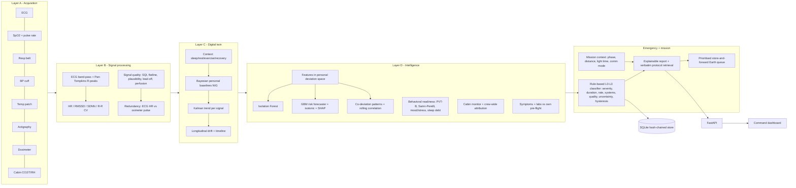

# E. System architecture

## Per-minute data flow (`ares/engine.py::tick`)
1. Mission context → modelled GCR rate, link state, light time.
2. Sensors (simulated) → readings + device status (+10-s ECG window in live mode).
3. Signal quality → clean readings, per-signal quality 0–1, faults, HR fallback to oximeter.
4. Digital twin → context, personal z-scores with uncertainty, bands, Kalman slopes, sleep.
5. Features (deviation space) → anomaly score, 30-min risk, SHAP.
6. Patterns + classifier → level 0–3, reasons, confidence, sensor alert, repeat-measurement requests.
7. Incidents → open / escalate / resolve (15-min hysteresis, 3-h post-event monitoring), reports,
   protocols, crew notification, Earth priority.
8. Radiation (SPE detector), cabin (CO₂ + attribution), behavioral (daily tests), store, comm queue.

## What runs where

| Component | Onboard (edge) | Earth / mission support |
|---|---|---|
| Acquisition, quality, digital twin, classifier, reports, protocol retrieval, comm queue, local store | ✔ (all, offline) | — |
| Anomaly + forecaster **inference** (≈ 10 ms per astronaut per minute, single CPU thread) | ✔ | — |
| Model **training**, recalibration, drift review | — | ✔ (models uplinked when the link allows; hashes verified onboard) |
| Knowledge-base approval and updates | — | ✔ flight surgeons sign off; onboard copy is read-only |
| Behavioral raw scores | ✔ astronaut + CMO | category only |

No claim is made about specific flight computers; latency was measured on a laptop-class CPU
(see `GET /api/system`, "edge tick").

## Fault tolerance
- Sensor level: plausibility, flatline, lead-off, perfusion checks; redundant HR source; faulted channels never escalate medically.
- Software level: an exception during one mission minute is caught by the mission clock, logged as a contained
  software fault (visible in `/api/system` and the event log) and monitoring continues. This was added after a
  real bug stopped the clock during testing; `tests/test_system.py` holds the regression test.
- Data level: hash-chained local store; model files verified against hashes recorded at training.

## Operating modes
- **Earth-connected** (one-way light time ≤ 10 s): reports sent as generated.
- **Communication-delay**: analysis continues; reports state the earliest possible ground reply.
- **Communication-blackout** (solar conjunction, failure, or forced): messages queue (nothing dropped);
  reports say "Earth link unavailable – act on onboard protocols".

## Technology choices (and why)

| Choice | Why | Rejected alternative |
|---|---|---|
| Python, NumPy/SciPy | Signal processing + statistics with well-tested filters | — |
| scikit-learn HistGradientBoosting | Same model family as XGBoost/LightGBM, no extra native deps, fast single-row inference | XGBoost (extra dependency, same accuracy class here) |
| Isolation Forest | Trains on nominal data only (no emergency labels needed); fast | LOF, OC-SVM, autoencoder — compared in `reports/EVALUATION.md` |
| SHAP TreeExplainer | Exact attributions for tree models | LIME (sampling noise) |
| FastAPI + Pydantic | Typed, validated local API; auto-docs at `/docs` | Streamlit (harder to build a multi-view mission UI, re-runs whole script) |
| Plain JS + Plotly served locally | Works offline; no build step for the team | React (build tooling, not needed for 6 views) |
| SQLite + hash chain | Zero-admin, single-file, survives restarts; tamper evidence | Postgres/time-series DB (needs a server) |
| Docker | One-command run for judges | — |
| **No LLM onboard** | Hallucinated medical text is a hazard; compute-heavy | RAG with generation (roadmap: phrasing only, never content) |
